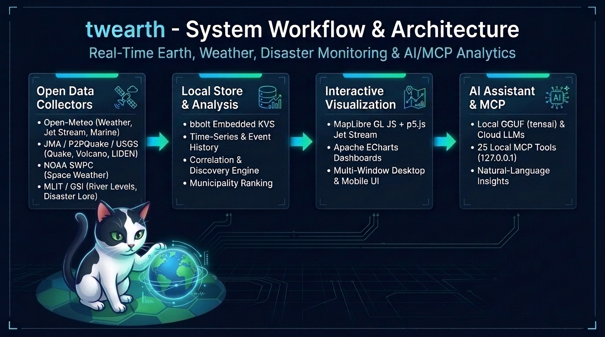
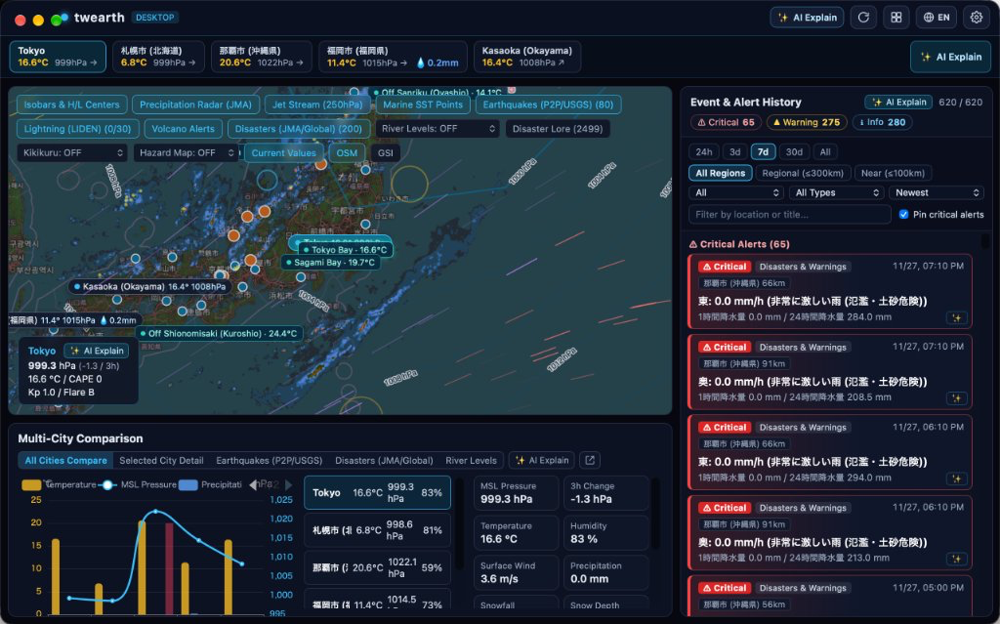
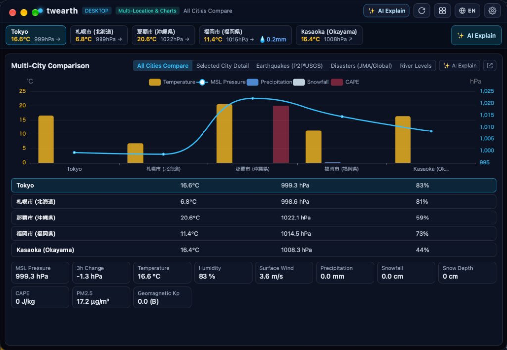
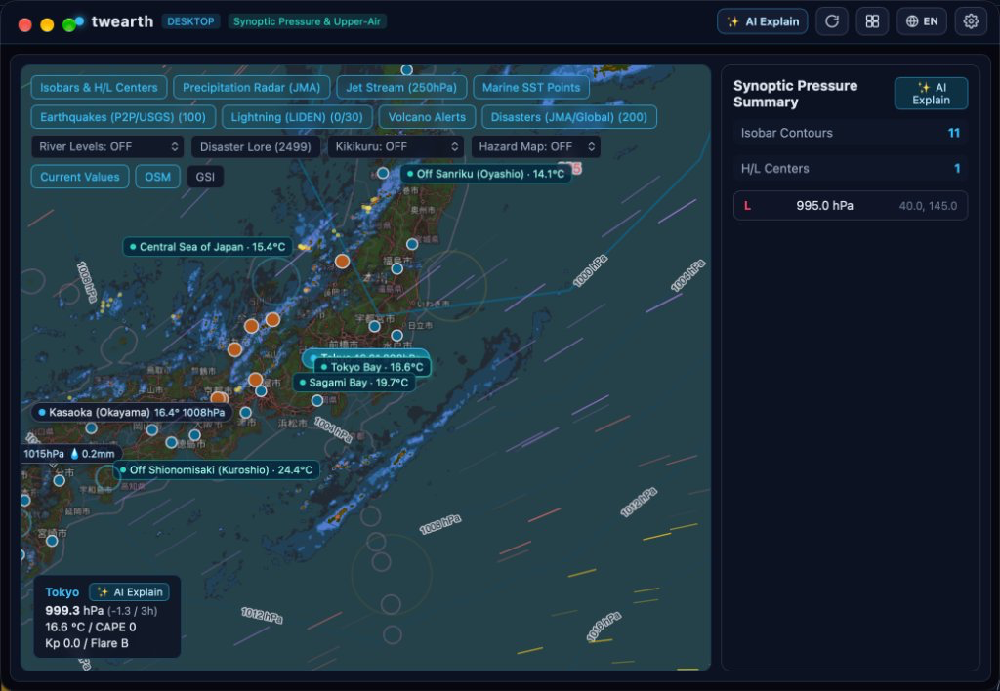
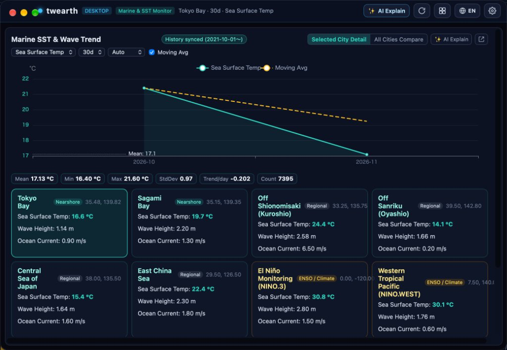
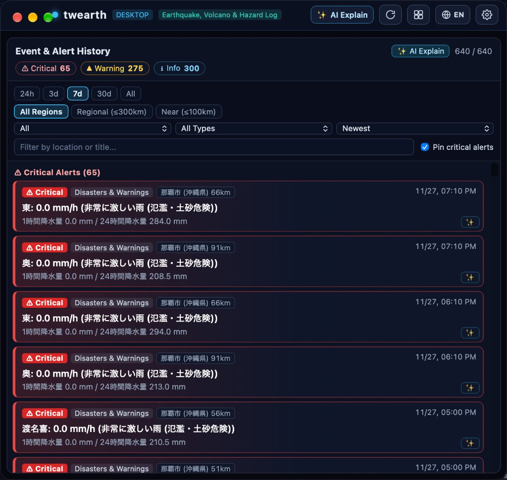
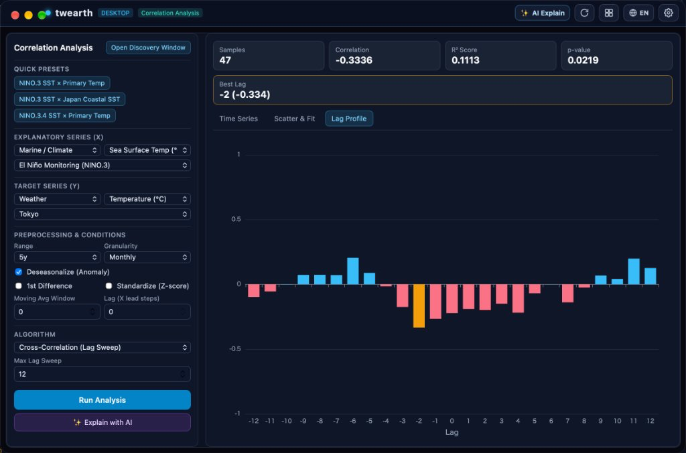
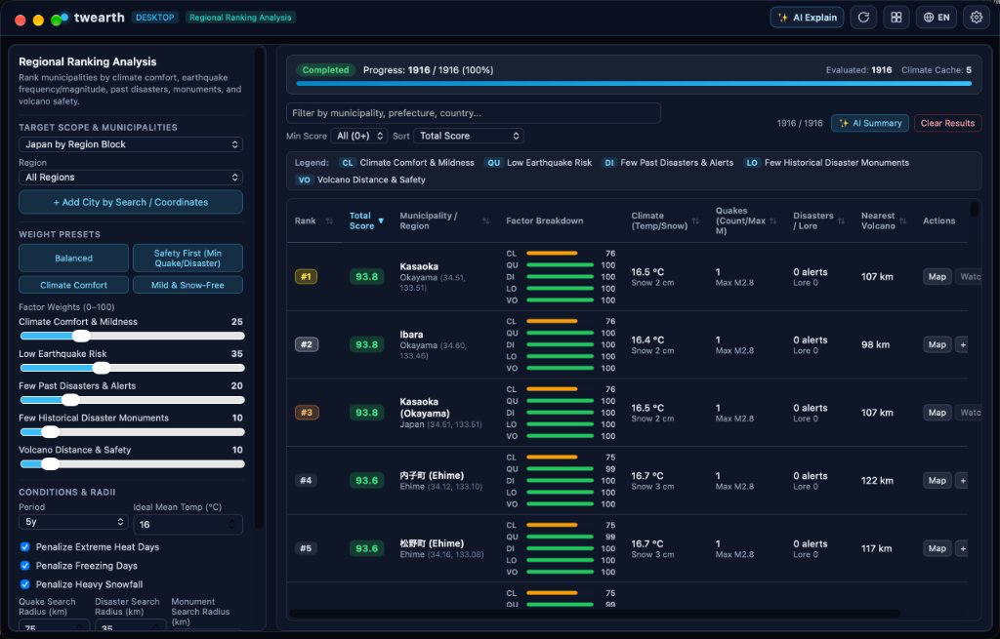
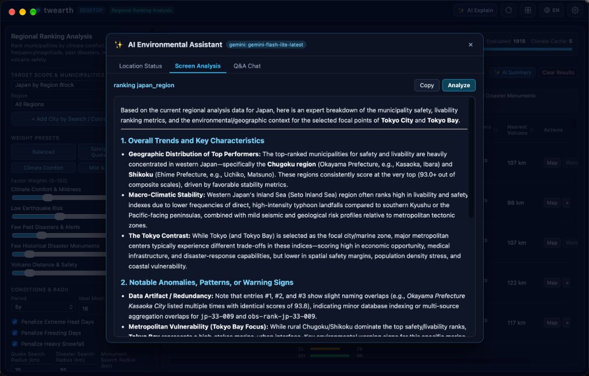
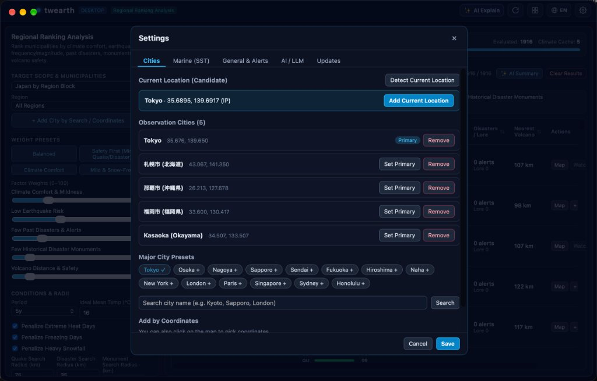

# twearth 🌍⚡

**twearth** (TWSNMP Earth) is a cross-platform desktop and mobile application for real-time monitoring, visualization, and statistical/AI analysis of global and local natural environment data—including weather, jet streams, sea surface temperatures, earthquakes, volcanoes, lightning, river levels, and space weather—with **no user registration or API keys required**. Built with [Wails v3](https://v3.wails.io/), [Svelte 5](https://svelte.dev/), and Go. Part of the TWSNMP project family.

> 🇯🇵 [日本語版 README はこちら](README_ja.md)

---

## 🗺️ System Workflow & Architecture



*twearth integrates open environmental data collection (Open-Meteo, JMA, P2PQuake, USGS, NOAA SWPC, MLIT, GSI) with local `bbolt` time-series storage, MapLibre + p5.js + ECharts visualization, statistical correlation & regional ranking engines, and local/cloud AI + MCP server integration.*

---

## ✨ Key Features

- 🗺️ **Interactive Map & Real-Time p5.js Overlays** — Combines `MapLibre GL JS` (dark OSM, GSI pale/relief/hazard tiles, JMA radar/Kikikuru) with a synchronized `p5.js` canvas to animate 250 hPa jet stream particle flows, earthquake epicenters, and LIDEN lightning flashes.
- 🌦️ **Multi-Location Weather, Air Quality & Marine Monitoring** — Tracks surface pressure (with 3-hour change), temperature, humidity, CAPE, PM2.5, yellow dust, UV index, and marine SST / wave height / ocean currents—including El Niño / climate monitoring regions (`NINO.3`, `NINO.WEST`, `IOBW`).
- 🌋 **Comprehensive Disaster & Hazard Watch** — Real-time WebSocket earthquake & tsunami feeds (P2PQuake) + USGS global quakes, JMA volcano alert levels & XML bulletins, LIDEN lightning proximity, JMA Kikikuru risk maps, MLIT river levels, and GSI disaster lore monuments.
- ☀️ **Synoptic & Space Weather** — Visualizes synoptic isobars & H/L pressure centers, upper-air 250 hPa / 500 hPa winds, and NOAA SWPC planetary Kp-index & GOES X-ray solar flux.
- 📊 **Correlation Analysis, Discovery & Regional Ranking** — Built-in statistical engine supporting lagged correlation, deseasonalization, differencing, robustness evaluation, automated correlation discovery, and Japan-wide municipality environmental ranking.
- 🪟 **Multi-Window Desktop Workspace & Mobile UI** — Detach Charts, Synoptic, Marine, Events, Correlation, Discovery, and Ranking panels into independent windows with one-click tiling (Grid, Horizontal, Vertical, Cascade), plus a responsive tab layout for iOS/Android.
- 🤖 **AI Assistant & Local Embedded LLM (`tensai`)** — Ask natural-language questions about your environment data using an embedded local GGUF model (`tensai` with built-in Model Manager) or cloud/local LLMs (**Google Gemini**, **OpenRouter**, **OpenAI / Compatible**, **Anthropic Claude**, **Ollama**).
- 🔌 **Local-Only MCP Server (25 Tools)** — Built-in Streamable HTTP MCP server (`127.0.0.1:18088`, disabled by default) exposing environmental summaries, disaster logs, correlation analysis, and municipality rankings to AI agents.
- 💾 **Local-First Persistence & Auto-Update** — Embedded `bbolt` key-value store keeps all configuration, time-series history, and event logs locally; desktop builds support automatic updates via GitHub Releases.
- 🌐 **Bilingual UI** — Seamless switching between English and Japanese interfaces.

---

## 🖥️ User Interface & Operation Guide

twearth provides a unified main workspace on desktop with detachable multi-window panels and a touch-friendly tabbed layout on mobile.

### 1. Main Map & Live Dashboard


- **Location Strip & Quick Metrics**: Displays your primary and registered observation cities with current temperature, pressure, 3h pressure trend, CAPE, and nearby lightning counts.
- **Interactive Layer Controls**: Toggle 250 hPa jet stream particles, isobars & H/L centers, JMA precipitation radar, earthquakes, volcano alerts, LIDEN lightning, river levels, Kikikuru (landslide/inundation/flood), GSI hazard maps, disaster lore monuments, and marine SST points.
- **Map Coordinate Picking**: Click anywhere on the map to inspect or register new observation points.

### 2. Multi-Location & Time-Series Charts


- **Apache ECharts Visualizations**: Compare pressure trends, temperature, precipitation, CAPE, PM2.5/dust, and nearby lightning across multiple registered cities or focus on a single city's detailed history.
- **Window Popout**: Pop out the charts panel into its own dedicated window for multi-monitor setups.

### 3. Synoptic, Space Weather & Marine SST Monitor



- **Synoptic & Space Weather**: Inspect 250 hPa / 500 hPa upper-air patterns alongside NOAA SWPC Kp-index geomagnetic storm gauges and GOES X-ray solar flux charts.
- **Marine & ENSO Monitoring**: Auto-select nearshore/regional sea points relative to your primary city and monitor El Niño / climate indices (`NINO.3`, `NINO.WEST`, `IOBW`) with sea surface temperature, wave height, and ocean current vectors.

### 4. Event & Alert History (Earthquake, Volcano & Hazard Log)


- **Unified Disaster & Alert Feed**: Aggregates earthquakes, volcano alerts, heavy rain/flood warnings, and regional hazards with severity badges (`Critical`, `Warning`, `Info`), time-range filters (`24h`, `3d`, `7d`, `30d`, `All`), and distance filters (`All Regions`, `Regional ≤300km`, `Near ≤100km`).
- **One-Click AI Explanation**: Pin critical alerts to the top and click the AI button on any event or feed to get an immediate summary and risk assessment.

### 5. Correlation Analysis, Discovery & Regional Ranking


- **Correlation Analysis & Robustness**: Analyze relationships between environmental variables (e.g., pressure drops vs. lightning, SST vs. regional weather) with lag offsets, deseasonalization, differencing, and 4-mode robustness checks.
- **Correlation Discovery**: Automatically scans combinations of metrics and locations to surface statistically notable correlations.
- **Municipality Ranking**: Ranks and compares Japanese municipalities across environmental and hazard metrics.



### 6. AI Assistant & Local Model Manager


- **Context-Aware Q&A**: Discuss current weather, recent earthquakes, correlation findings, or disaster risks with an AI assistant that automatically receives relevant local telemetry context.
- **Embedded Local LLM (`tensai`)**: Download and run GGUF models directly on your machine without external API keys or internet access for inference.

### 7. Settings & Multi-Window Controls


- **Organized Tabbed Settings**:
  - **Locations**: Manage primary/secondary cities (search by name, auto-detect, presets, or coordinates).
  - **Marine**: Configure auto-selection of nearshore/regional sea areas and ENSO/climate points.
  - **General**: Polling intervals, alert thresholds, UI preferences, and Local MCP Server (`127.0.0.1:18088`) toggle.
  - **AI / LLM**: Choose `tensai` (embedded GGUF), Google Gemini, OpenRouter, OpenAI / Compatible, Anthropic, or Ollama.
  - **Update** (Desktop only): Check and apply GitHub Release updates.

---

## 📡 Data Sources (No API Keys Required)

| Category | Provider / Source | Data Collected |
|---|---|---|
| **Weather & Upper-Air** | [Open-Meteo Forecast API](https://open-meteo.com/) | Surface/MSL pressure, temp, humidity, precipitation, CAPE, 250 hPa & 500 hPa wind/geopotential grids |
| **Air Quality** | [Open-Meteo Air Quality API](https://open-meteo.com/) | PM2.5, PM10, dust, UV index |
| **Marine & SST** | [Open-Meteo Marine API](https://open-meteo.com/) | Sea surface temperature (SST), wave height, ocean current velocity & direction |
| **Earthquakes & Tsunami** | [P2PQuake API v2](https://www.p2pquake.net/) / [JMA](https://www.jma.go.jp/) / [USGS](https://earthquake.usgs.gov/) | Real-time WebSocket hypocenter/intensity, tsunami forecasts, global M4.5+ earthquakes |
| **Site Amplification** | [NIED J-SHIS](https://www.j-shis.bosai.go.jp/) | Surface ground amplification factor & geomorphologic classification |
| **Volcanoes** | [JMA Volcano JSON / XML](https://www.jma.go.jp/) | Active volcano list, eruption warning levels, eruption & ashfall bulletins |
| **Lightning & Radar** | [JMA LIDEN / Nowcast / Kikikuru](https://www.jma.go.jp/) | Lightning strikes, precipitation radar, landslide/inundation/flood risk tiles |
| **Rivers & Lore** | [MLIT](https://www.river.go.jp/) / [GSI](https://www.gsi.go.jp/) | River water levels, GSI base/hazard tiles, natural disaster lore monuments |
| **Space Weather** | [NOAA SWPC](https://www.swpc.noaa.gov/) | Planetary Kp-index (1m) & GOES primary X-ray flux (6h) |

---

## 🔌 Local MCP Server Integration

Desktop builds include a local-only **Model Context Protocol (MCP)** server using Streamable HTTP (`POST /mcp`, `GET /mcp`, `DELETE /mcp`) bound strictly to `127.0.0.1:<port>` (default port `18088`, disabled by default) with loopback IP, `Host`, and `Origin` validation.

### Exposed MCP Tools (25 Tools)
- **Current & Summary**: `get_earth_summary`, `get_current_weather`, `get_current_marine`, `get_synoptic_and_space`
- **Hazards & Disasters**: `list_alert_events`, `list_recent_quakes`, `list_volcanoes`, `list_active_disasters`, `get_river_levels`
- **History & Lore**: `analyze_environment_history`, `search_disaster_lore`
- **Locations & System**: `search_and_manage_locations`, `trigger_data_refresh`, `get_mcp_and_system_status`
- **Correlation Analysis**: `get_correlation_catalog`, `analyze_correlation`, `evaluate_correlation_robustness`, `manage_correlation_discovery`, `list_correlation_discoveries`
- **Municipality Ranking**: `get_municipality_ranking_catalog`, `manage_municipality_ranking`, `list_municipality_rankings`, `get_municipality_ranking_detail`, `compare_municipalities`, `get_analysis_overview`

---

## 🛠️ Tech Stack

| Component | Technology |
|---|---|
| **App Framework** | [Wails v3](https://v3.wails.io/) (Desktop & Mobile) |
| **Backend** | Go 1.27 (`GOEXPERIMENT=simd`) |
| **Frontend** | Svelte 5 (Runes) + TypeScript + Vite + Tailwind CSS |
| **Mapping & Particles** | `MapLibre GL JS` + `p5.js` |
| **Charts & Gauges** | `Apache ECharts` |
| **Database** | [bbolt](https://github.com/etcd-io/bbolt) (Embedded Key-Value Store) |
| **AI / LLM** | `github.com/mattn/tensai` (Embedded GGUF) + `langchaingo` |
| **Packaging** | macOS Universal PKG (Notarized), Windows ZIP / NSIS Installer, Linux tar.gz |

---

## 🚀 Installation & Releases

### Download Prebuilt Packages

Visit the [Releases](https://github.com/twsnmp/twearth/releases) page to download binaries for your platform:

- **macOS (Universal: Apple Silicon & Intel)**: Download the signed and notarized `.pkg` installer (built via `scripts/release-mac.sh`).
- **Windows (x64)**: Download `twearth-windows-amd64-installer.exe` or `twearth-windows-amd64.zip`.
- **Linux (x64)**: Download `twearth-linux-amd64.tar.gz`, extract, and run `twearth` (requires `libgtk-4-dev` / `libwebkitgtk-6.0-dev` runtime libraries).

---

## 💻 Development Setup

### Prerequisites

- [mise](https://mise.jdx.dev/) (Manages Go 1.27 and Node.js 22 via `mise.toml`)
- [Wails v3 CLI](https://v3.wails.io/) (`go install github.com/wailsapp/wails/v3/cmd/wails3@v3.0.0`)
- Linux only: `sudo apt-get install -y libgtk-4-dev libwebkitgtk-6.0-dev build-essential pkg-config`
- Mobile builds (optional): Xcode (iOS) or JDK + Android SDK/NDK (Android)

### Setup & Run

```bash
# Install Go and Node.js via mise
mise install

# Install frontend dependencies
cd frontend
npm install
cd ..

# Run in development mode
mise run dev

# Run Go tests
mise run test

# Build desktop binary
mise run build

# Build, sign, and notarize macOS Universal release
mise run release-mac
```

---

## 🗄️ Data Directories

Configuration, cached time-series data, event logs, and the `bbolt` database are stored locally in the OS application config directory:

| Platform | Default Path |
|---|---|
| **macOS** | `~/Library/Application Support/twearth/` |
| **Windows** | `%APPDATA%\twearth\` |
| **Linux** | `~/.config/twearth/` |

---

## 📄 Specifications & License

- Architecture & Design Specification: [SPEC.md](SPEC.md)
- License: [Apache License 2.0](LICENSE)
