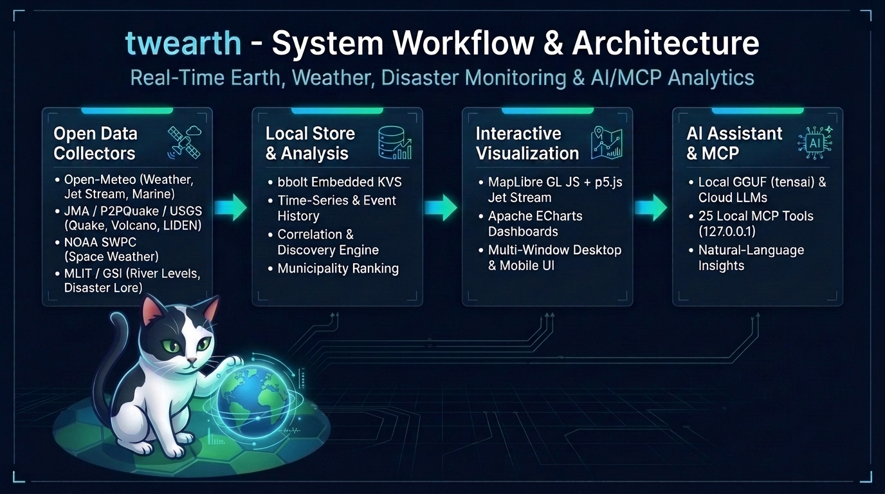
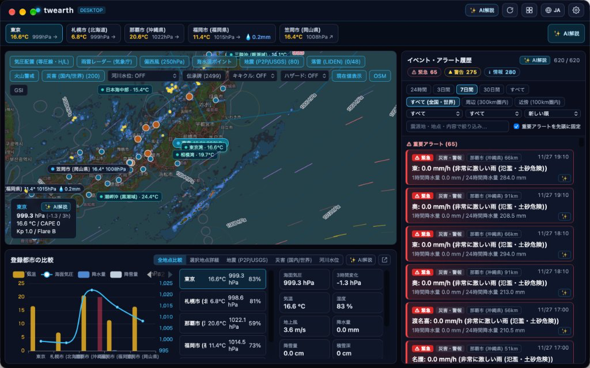
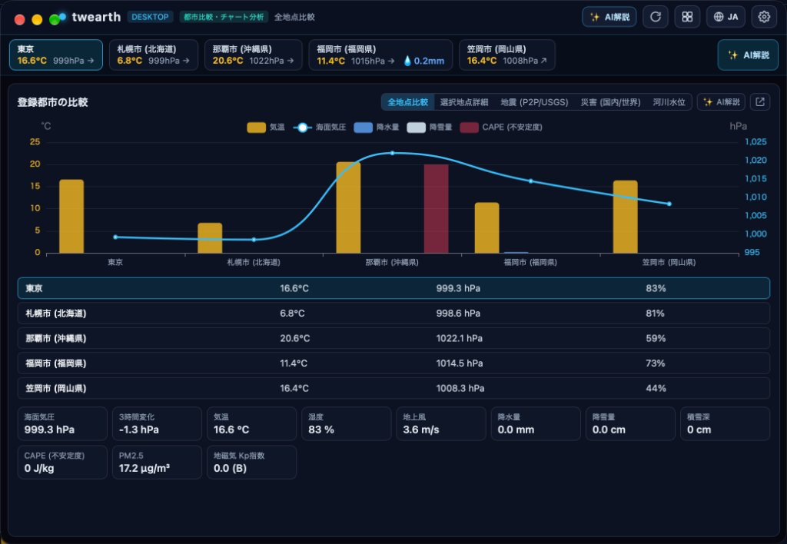
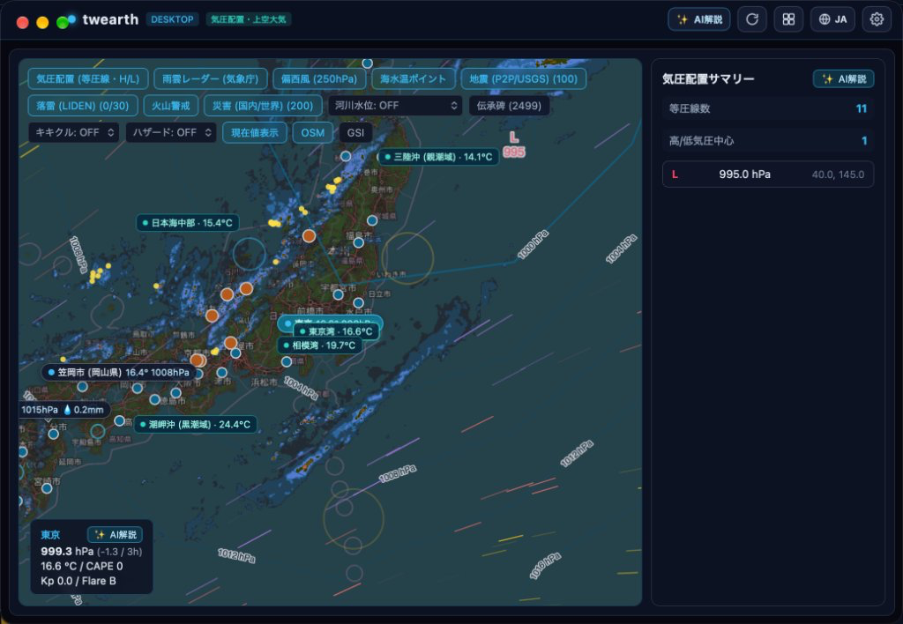
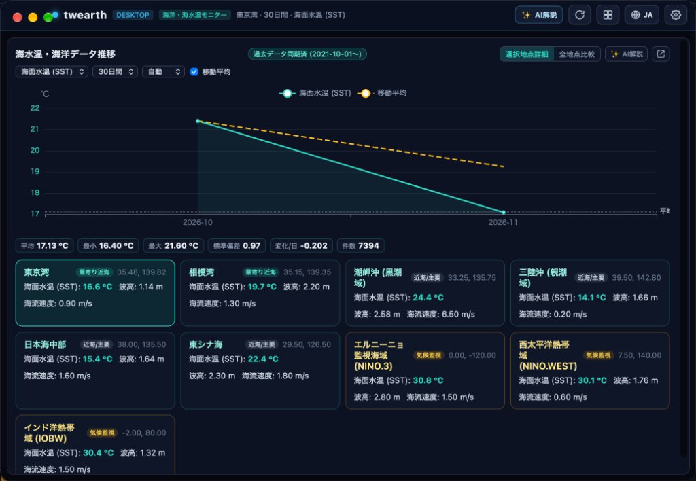
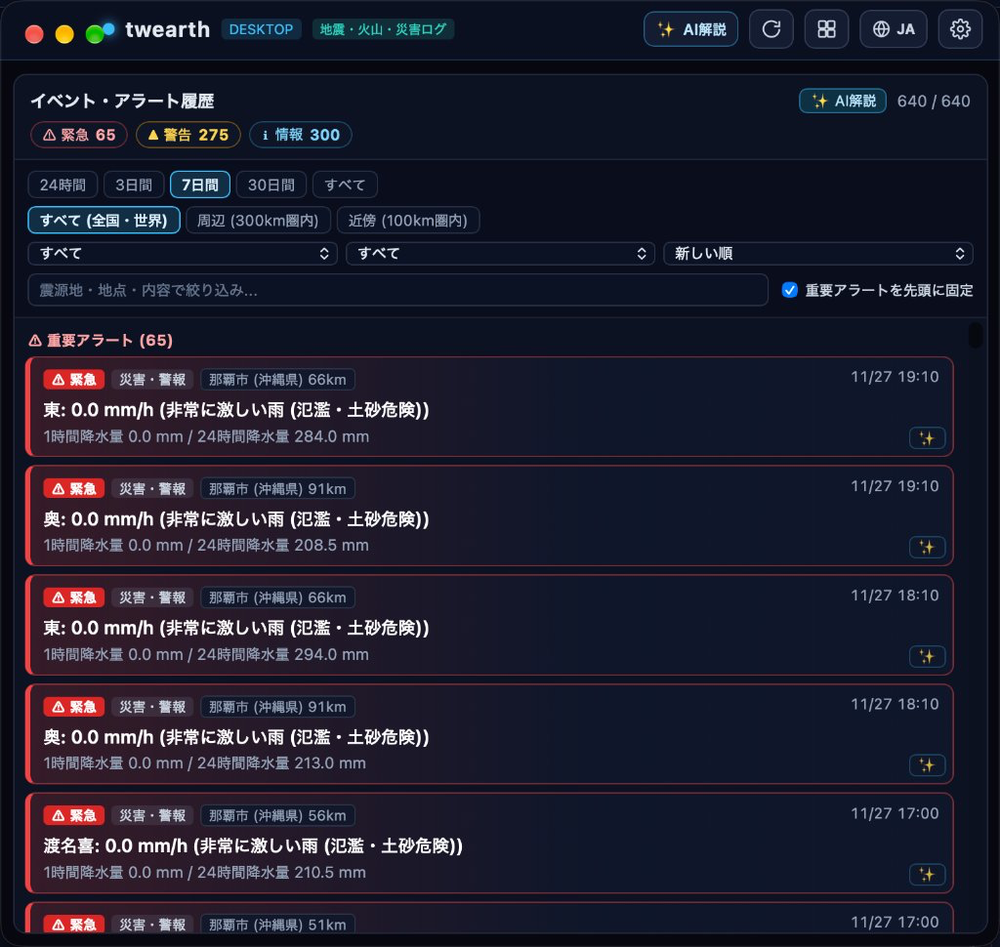
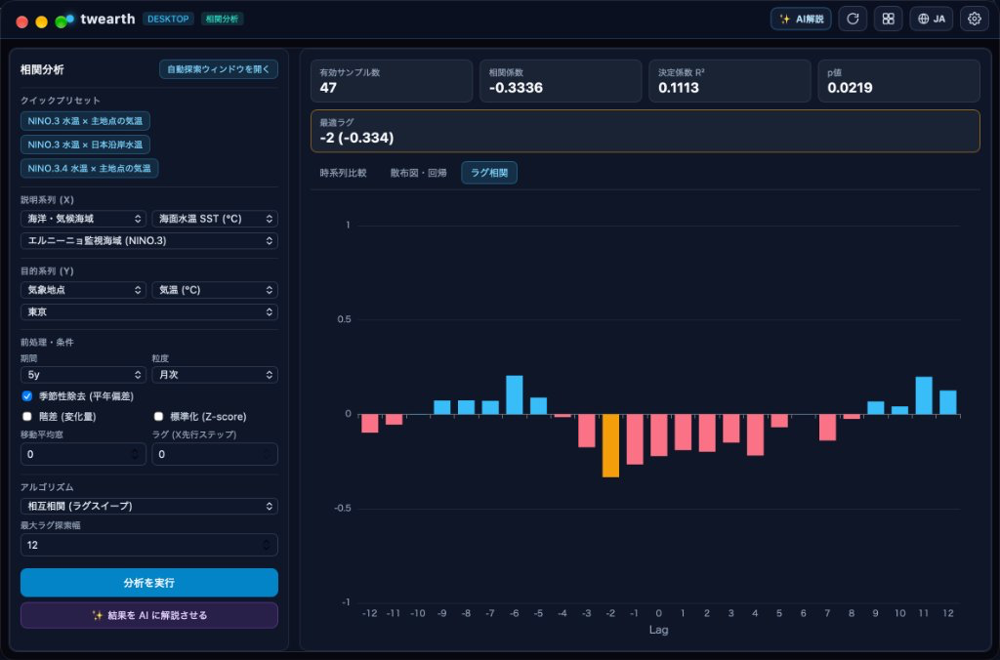
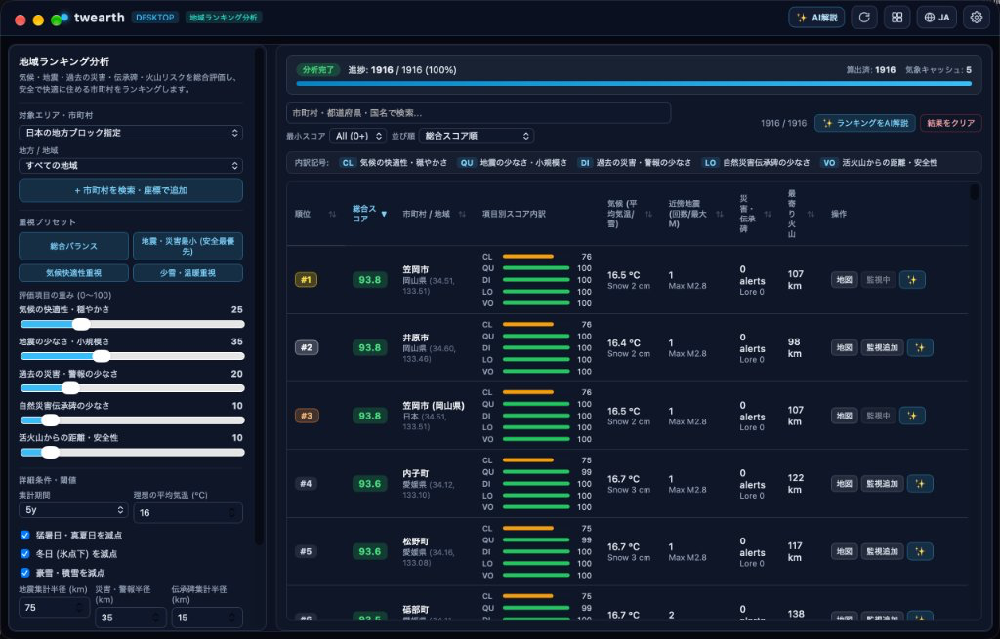
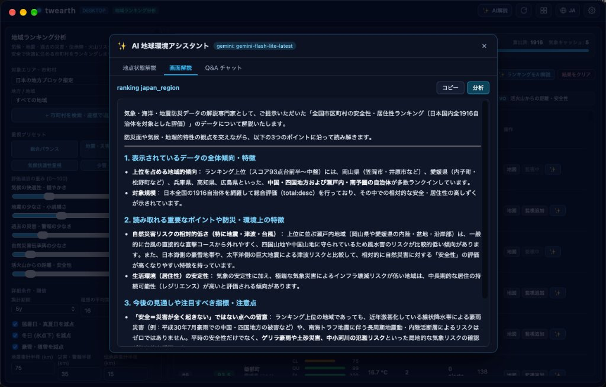
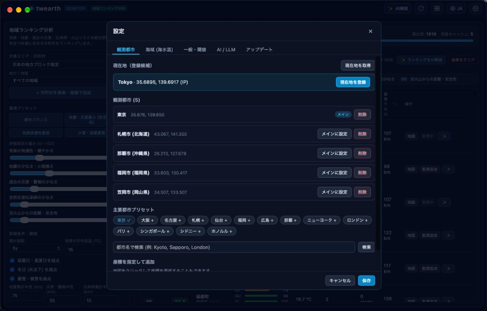

# twearth 🌍⚡

**twearth**（TWSNMP Earth）は、ユーザー登録・APIキー不要のオープンAPIから、気象・気圧・偏西風・海水温・地震・火山・落雷・河川水位・宇宙天気などの地球環境データをリアルタイムに取得し、地図可視化・時系列チャート・統計的相関分析・AI/MCP連携までを統合したクロスプラットフォームアプリケーションです。[Wails v3](https://v3.wails.io/) と [Svelte 5](https://svelte.dev/)、Go で構築されており、TWSNMPシリーズプロジェクトの一つです。

> 🇬🇧 [English README](README.md)

---

## 🗺️ システム構成・ワークフロー



*twearth は、各種オープンAPI（Open-Meteo, 気象庁, P2P地震情報, USGS, NOAA SWPC, 国土交通省, 国土地理院）からのデータ収集、`bbolt` によるローカル時系列永続化、MapLibre + p5.js + ECharts によるリアルタイム可視化、相関分析・自治体ランキングエンジン、およびローカル/クラウド AI・MCP サーバー連携を一貫して統合しています。*

---

## ✨ 主な特徴

- 🗺️ **インタラクティブ地図 & リアルタイム p5.js オーバーレイ** — `MapLibre GL JS`（ダーク地図、国土地理院 淡色・陰影・ハザードマップ、気象庁レーダー・キキクル）の上に透過 `p5.js` キャンバスを重ね、250hPa 偏西風の蛇行パーティクル、震源波紋、LIDEN 落雷閃光を滑らかにアニメーション描画。
- 🌦️ **多拠点の気象・大気質・海洋モニタリング** — 気圧（3時間変化量含む）・気温・湿度・CAPE・PM2.5・黄砂・UV指数に加え、近海・広域の海面水温（SST）・波高・海流、およびエルニーニョ監視海域（`NINO.3`, `NINO.WEST`, `IOBW`）を自動追跡。
- 🌋 **地震・火山・防災情報の統合監視** — P2P地震情報 WebSocket（震源・震度・津波・緊急地震速報）と USGS 世界地震、気象庁の活火山警戒レベル・噴火速報、LIDEN 落雷接近検知、キキクル（土砂・浸水・洪水）、国土交通省 河川水位、国土地理院 自然災害伝承碑を統合表示。
- ☀️ **総観気象 & 宇宙天気** — 等圧線・高低気圧、上空 250hPa/500hPa の風況、NOAA SWPC の地磁気嵐 Kp 指数や GOES 太陽 X 線フラックスを可視化。
- 📊 **相関分析・自動発見 & 自治体ランキング** — 時差相関、季節調整、差分変換、4モードのロバスト性評価を備えた統計的相関分析と自動発見エンジン、さらに全国自治体の環境・防災ランキング分析を搭載。
- 🪟 **マルチウィンドウ対応 & モバイルレスポンシブ UI** — デスクトップ版ではチャート・総観気象・海洋・イベント・相関分析・相関発見・ランキングを独立ウィンドウとして切り出し可能（グリッド・左右・上下・カスケード整列対応）。iOS / Android 向けタブレイアウトも装備。
- 🤖 **AI アシスタント & 組み込みローカル LLM（`tensai`）** — 組み込み GGUF モデル（`tensai` + モデルマネージャ）により外部 API キーなしでローカル推論できるほか、**Google Gemini**、**OpenRouter**、**OpenAI / 互換 API**、**Anthropic Claude**、**Ollama** にも対応。
- 🔌 **ローカル専用 MCP サーバー（25 ツール）** — Streamable HTTP（`127.0.0.1:18088`、デフォルト無効）で環境サマリー・災害履歴・相関分析・自治体ランキングを外部 AI エージェントへ安全に提供（ループバック IP / Host / Origin 検証つき）。
- 💾 **完全ローカル永続化 & 自己アップデート** — 組み込み KVS（`bbolt`）で設定・時系列履歴・イベントログをローカル保存。デスクトップ版は GitHub Releases からの自動アップデートに対応。
- 🌐 **二言語 UI 対応** — 日本語と英語の表示切替に対応。

---

## 🖥️ 画面と操作方法

twearth は、デスクトップでは地図と各種パネルを統合したメイン画面＋マルチウィンドウ構成、モバイルではボトムタブによる直感的な操作性を提供します。

### 1. メイン地図 & ライブダッシュボード


- **拠点ストリップ & 主要指標**: 登録した観測都市の現在気温・気圧・3時間気圧変化・CAPE・周辺落雷数を一覧表示。
- **レイヤー切替**: 250hPa 偏西風パーティクル、等圧線・高低気圧、気象庁雨雲レーダー、地震、火山、LIDEN 落雷、河川水位、キキクル（土砂災害・浸水害・洪水）、ハザードマップ、災害伝承碑、海面水温ポイントを自由にオーバーレイ。
- **地図クリック座標登録**: 地図上の任意の地点をクリックして観測地点や海洋ポイントを追加可能。

### 2. 多拠点比較 & 時系列チャート


- **Apache ECharts による時系列可視化**: 複数都市の気圧推移、気温、降水量、CAPE、PM2.5/黄砂、周辺落雷数の比較や、単一都市の詳細履歴を確認できます。
- **別ウィンドウ切り出し**: チャートパネルを独立ウィンドウとして開き、マルチモニター環境に配置できます。

### 3. 総観気象・宇宙天気 & 海洋 SST モニタ



- **総観気象 & 宇宙天気**: 上空 250hPa / 500hPa の風況や、NOAA SWPC の Kp 指数ゲージ・GOES 太陽 X 線フラックス推移を確認できます。
- **海洋 & エルニーニョ監視**: メイン都市に応じた近海・広域海域の自動選定に加え、`NINO.3` / `NINO.WEST` / `IOBW` などの気候監視海域の海面水温・波高・海流を監視します。

### 4. イベント・アラート履歴（地震・火山・災害ログ）


- **統合災害 & アラートフィード**: 地震・火山警戒・大雨/氾濫警報・各種災害情報を重要度バッジ（`緊急`, `警告`, `情報`）、期間フィルタ（`24時間`, `3日間`, `7日間`, `30日間`, `すべて`）、距離フィルタ（`すべて`, `周辺 300km圏内`, `近傍 100km圏内`）で整理して表示します。
- **ワンクリック AI 解説**: 重要アラートを先頭に固定でき、各イベントや履歴全体の AI 解説ボタンから即座に状況要約とリスク評価を得られます。

### 5. 相関分析・自動発見 & 自治体ランキング


- **相関分析 & ロバスト性評価**: 気象・海洋・災害指標間の相関をラグ（時間差）、季節成分除去、差分変換を含めて統計的に検証できます。
- **相関自動発見**: 指標と拠点の組み合わせを自動スキャンし、注目すべき相関関係を一覧化します。
- **自治体ランキング**: 全国の市区町村を対象に、環境・気象・災害リスク指標のランキングと比較を行います。



### 6. AI アシスタント & ローカルモデル管理


- **環境コンテキスト付き Q&A**: 現在の気象・地震・相関分析結果を踏まえて AI に質問・解説を依頼できます。
- **組み込みローカル LLM（`tensai`）**: モデルマネージャから GGUF モデルを取得し、外部サーバー不要でローカル推論を実行できます。

### 7. 環境設定 & マルチウィンドウ操作


- **タブ整理された設定画面**:
  - **拠点設定 (Locations)**: 観測都市の検索・現在地取得・プリセット・座標登録。
  - **海洋設定 (Marine)**: 近海・広域海域およびエルニーニョ監視海域の自動選定設定。
  - **一般設定 (General)**: ポーリング周期、アラート閾値、ローカル MCP サーバー（`127.0.0.1:18088`）の有効化設定。
  - **AI / LLM 設定**: `tensai`（ローカル GGUF）、Google Gemini、OpenRouter、OpenAI / 互換 API、Anthropic Claude、Ollama の設定。
  - **アップデート (Update)**（デスクトップ版のみ）: GitHub Releases からの更新確認と適用。

---

## 📡 データソース（すべてユーザー登録・APIキー不要）

| カテゴリ | 提供元 / API | 取得データ |
|---|---|---|
| **気象・上空風** | [Open-Meteo Forecast API](https://open-meteo.com/) | 地上/海面更正気圧、気温、湿度、降水量、CAPE、250hPa / 500hPa 風向風速・ジオポテンシャル高度 |
| **大気質** | [Open-Meteo Air Quality API](https://open-meteo.com/) | PM2.5、PM10、黄砂（Dust）、UV インデックス |
| **海洋・海水温** | [Open-Meteo Marine API](https://open-meteo.com/) | 海面水温（SST）、波高、海流速度・方向 |
| **地震・津波** | [P2P地震情報 API v2](https://www.p2pquake.net/) / [気象庁](https://www.jma.go.jp/) / [USGS](https://earthquake.usgs.gov/) | WebSocket リアルタイム震源・震度・津波予報、世界 M4.5+ 地震 |
| **地盤増幅率** | [防災科研 J-SHIS](https://www.j-shis.bosai.go.jp/) | 表層地盤増幅率・微地形区分 |
| **火山情報** | [気象庁 火山 JSON / XML](https://www.jma.go.jp/) | 活火山一覧、噴火警戒レベル、噴火速報・降灰予報 |
| **落雷・レーダー** | [気象庁 LIDEN / ナウキャスト / キキクル](https://www.jma.go.jp/) | 落雷位置、雨雲レーダー、土砂・浸水・洪水危険度タイル |
| **河川・災害伝承碑** | [国土交通省](https://www.river.go.jp/) / [国土地理院](https://www.gsi.go.jp/) | 河川水位、ハザードマップ・地理院タイル、自然災害伝承碑 |
| **宇宙天気** | [NOAA SWPC](https://www.swpc.noaa.gov/) | 地磁気嵐 Kp 指数、GOES 太陽 X 線フラックス |

---

## 🔌 ローカル専用 MCP サーバー連携

デスクトップ版には **Model Context Protocol (MCP)** サーバー機能が内蔵されています。デフォルトは無効で、有効化すると `127.0.0.1:18088`（Streamable HTTP: `POST/GET/DELETE /mcp`）で待機し、ループバック IP・`Host`・`Origin` 検証により外部からの接続を遮断します。

### 提供ツール一覧（25 ツール）
- **サマリー・現在値**: `get_earth_summary`, `get_current_weather`, `get_current_marine`, `get_synoptic_and_space`
- **監視・災害検索**: `list_alert_events`, `list_recent_quakes`, `list_volcanoes`, `list_active_disasters`, `get_river_levels`
- **履歴分析・伝承碑**: `analyze_environment_history`, `search_disaster_lore`
- **拠点・システム操作**: `search_and_manage_locations`, `trigger_data_refresh`, `get_mcp_and_system_status`
- **相関分析・発見**: `get_correlation_catalog`, `analyze_correlation`, `evaluate_correlation_robustness`, `manage_correlation_discovery`, `list_correlation_discoveries`
- **自治体ランキング**: `get_municipality_ranking_catalog`, `manage_municipality_ranking`, `list_municipality_rankings`, `get_municipality_ranking_detail`, `compare_municipalities`, `get_analysis_overview`

---

## 🛠️ 技術スタック

| コンポーネント | 採用技術 |
|---|---|
| **アプリ基盤** | [Wails v3](https://v3.wails.io/)（デスクトップ & モバイル） |
| **バックエンド** | Go 1.27 (`GOEXPERIMENT=simd`) |
| **フロントエンド** | Svelte 5 (Runes) + TypeScript + Vite + Tailwind CSS |
| **地図 & パーティクル** | `MapLibre GL JS` + `p5.js` |
| **チャート & ゲージ** | `Apache ECharts` |
| **データベース** | [bbolt](https://github.com/etcd-io/bbolt)（組み込み Key-Value ストア） |
| **AI / LLM** | `github.com/mattn/tensai`（組み込み GGUF）+ `langchaingo` |
| **パッケージング** | macOS Universal PKG（Apple 公証対応）、Windows ZIP / NSIS インストーラ、Linux tar.gz |

---

## 🚀 インストールと起動

### 配布パッケージの利用

[Releases](https://github.com/twsnmp/twearth/releases) より、お使いの OS に合ったパッケージをダウンロードしてください。

- **macOS (Universal: Apple Silicon & Intel)**: 署名・公証済みの `.pkg` インストーラをダウンロードして実行してください。
- **Windows (x64)**: `twearth-windows-amd64-installer.exe` または `twearth-windows-amd64.zip` をダウンロードして実行してください。
- **Linux (x64)**: `twearth-linux-amd64.tar.gz` を展開して `twearth` を実行してください（要 `libgtk-4` / `libwebkitgtk-6.0` 系ライブラリ）。

---

## 💻 開発環境のセットアップ

### 前提条件

- [mise](https://mise.jdx.dev/)（`mise.toml` による Go 1.27 / Node.js 22 管理）
- [Wails v3 CLI](https://v3.wails.io/)（`go install github.com/wailsapp/wails/v3/cmd/wails3@v3.0.0`）
- Linux の場合: `sudo apt-get install -y libgtk-4-dev libwebkitgtk-6.0-dev build-essential pkg-config`
- モバイルビルド時（任意）: Xcode（iOS）または JDK + Android SDK/NDK（Android）

### セットアップ・開発・ビルド

```bash
# ツールチェーンのインストール
mise install

# フロントエンドの依存関係インストール
cd frontend
npm install
cd ..

# 開発モード起動
mise run dev

# Go テスト実行
mise run test

# デスクトップ版ビルド
mise run build

# macOS Universal 公証パッケージ作成
mise run release-mac
```

---

## 🗄️ データ保存場所

設定、キャッシュされた時系列データ、イベント履歴、および `bbolt` データベースファイルは以下の OS ディレクトリに保存されます。

| OS | デフォルトパス |
|---|---|
| **macOS** | `~/Library/Application Support/twearth/` |
| **Windows** | `%APPDATA%\twearth\` |
| **Linux** | `~/.config/twearth/` |

---

## 📄 仕様書・ライセンス

- 設計仕様書: [SPEC.md](SPEC.md)
- ライセンス: [Apache License 2.0](LICENSE)
